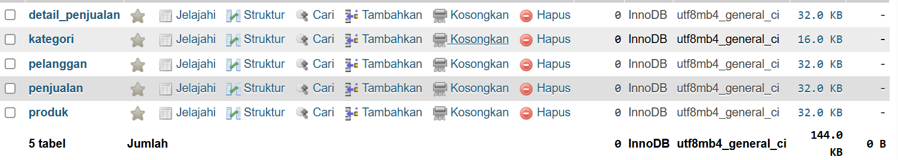
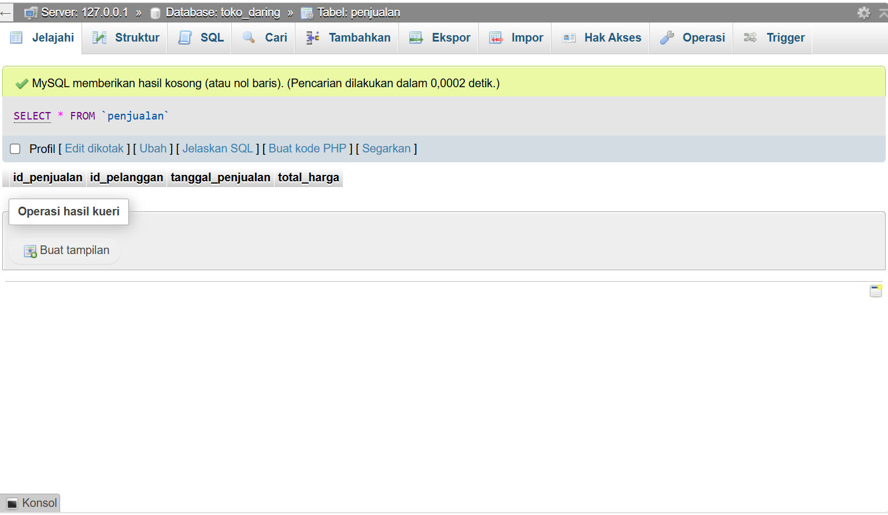

# Laporan Praktikum Basis Data - Pertemuan 05
**Nama:** Helen Awanda Saumitha  
**NIM:** 25430117
**Kelas:** D  
**Tanggal:** 3 November 2026  

---

## 1. Tujuan Praktikum
1. Menerapkan `CONSTRAINT CHECK` pada DDL untuk menjaga integritas data domain.
2. Memahami dan mengimplementasikan mekanisme referential integrity `ON DELETE SET NULL` pada hubungan *Foreign Key*.
3. Menganalisis kesesuaian kebijakan penghapusan data dengan aturan bisnis (AB-02) serta regulasi perlindungan data pribadi (UU PDP).
4. Menyusun DDL lengkap untuk proyek sistem toko daring yang *re-runnable* (dapat dijalankan ulang dari basis data kosong).
5. Menganalisis batasan $P + 2$ untuk validasi satu baris (*CHECK*) dan multi-baris (*Trigger* / *Procedure*).

---

## 2. Ringkasan Dasar Teori
- **Data Definition Language (DDL):** Perintah SQL yang digunakan untuk mendefinisikan struktur basis data, seperti `CREATE TABLE`, `ALTER TABLE`, dan `DROP TABLE`.
- **Integrity Constraints:**
  - **PRIMARY KEY:** Memastikan setiap baris dalam tabel bersifat unik dan tidak bernilai `NULL`.
  - **FOREIGN KEY:** Menjaga referensial antar tabel. Opsi `ON DELETE SET NULL` berguna agar ketika data referensi dihapus, nilai kunci tamu diubah menjadi `NULL` tanpa menghapus rekam medis/transaksi terkait.
  - **CHECK Constraint:** Memvalidasi bahwa nilai dalam suatu kolom memenuhi ekspresi logika tertentu (misal: `stok_min_barang >= 0`).
- **Aturan Batas $P + 2$:** Evaluasi aturan bisnis yang dapat diterapkan pada level tabel. Validasi yang sifatnya *single-row* (seperti `qty > 0`) dapat diatasi dengan `CHECK`, sedangkan validasi *multi-row* (seperti batas maksimum total unit dalam satu transaksi) memerlukan mekanisme tingkat lanjut seperti *Trigger* di DBMS MySQL/MariaDB.

---

## 3. Hasil Langkah Percobaan
*(Tambahkan tangkapan layar eksekusi skrip DDL dan pembuatan tabel di basis data)*

### Langkah 3.1 Eksekusi Skrip DDL Pembuatan Tabel
- **Tangkapan Layar:**
  
- **Keterangan:** Eksekusi skrip DDL berhasil membuat 5 tabel (`pelanggan`, `kategori`, `produk`, `penjualan`, `detail_penjualan`) tanpa *error*.

### Langkah 3.2 Verifikasi Struktur Tabel (DESCRIBE)
- **Tangkapan Layar:**
  
- **Keterangan:** Menampilkan struktur kolom, tipe data, serta *Key* untuk seluruh tabel yang telah dibuat.

---

## 4. Jawaban Titik Analisis

1. **Mengapa aturan batas $P + 2$ yang melibatkan transaksi multi-baris tidak dapat diselesaikan hanya dengan `CHECK` constraint?**
   - *Jawaban:* Constraint `CHECK` pada standar SQL MySQL/MariaDB hanya dapat mengevaluasi nilai dalam satu baris (*single row context*) yang sedang di-insert atau di-update. `CHECK` tidak dapat melakukan kueri (*subquery*) atau menghitung agregat (`SUM`, `COUNT`) dari baris-baris lain dalam tabel yang sama atau tabel berbeda. Oleh karena itu, batasan seperti "maksimal total item dalam satu transaksi adalah 100 unit" harus ditangani di tingkat aplikasi atau menggunakan *Trigger* pada Modul 14.

2. **Apa kelebihan dan risiko penerapan `ON DELETE SET NULL` pada tabel transaksi?**
   - *Jawaban:* 
     - **Kelebihan:** Menjaga integritas referensial agar transaksi historis tidak hilang (*orphan data*) saat akun pelanggan dihapus.
     - **Risiko:** Menghilangkan jejak identitas pemilik transaksi sehingga riwayat transaksi menjadi anonim, yang perlu dipertimbangkan dengan cermat dari sudut pandang pembukuan dan hukum.

---

## 5. Hasil Latihan dan Modifikasi

### Soal 1: Adding CHECK Constraint & Proof of Rejection
Menambahkan `CHECK (stok_min_barang >= 0)` pada tabel `produk` dan mengujinya dengan perintah `INSERT` yang melanggar aturan tersebut.

```sql
-- Perintah INSERT yang ditolak oleh CONSTRAINT CHECK
INSERT INTO produk (id_kategori, nama_produk, harga, stok, stok_min_barang) 
VALUES (1, 'Kemeja Flanel', 150000.00, 20, -5);
```

### Soal 2: Modifications ON DELETE SET NULL & Diskusi Kebijakan (AB-02 & UU PDP)
Mengubah `fk_penjualan_pelanggan` menggunakan `ON DELETE SET NULL`:

```sql
ALTER TABLE penjualan 
DROP FOREIGN KEY fk_penjualan_pelanggan;

ALTER TABLE penjualan 
ADD CONSTRAINT fk_penjualan_pelanggan 
FOREIGN KEY (id_pelanggan) REFERENCES pelanggan(id_pelanggan) 
ON UPDATE CASCADE ON DELETE SET NULL;
```

#### Diskusi Kesesuaian AB-02 dan UU PDP:
- **Kesesuaian AB-02 (Aturan Bisnis Toko Daring):** Sangat sesuai. Toko daring perlu menyajikan laporan keuangan dan histori penjualan yang akurat. Jika data pelanggan dihapus lalu seluruh transaksi ikut terhapus (`CASCADE`), maka laporan omzet dan inventaris perusahaan akan rusak. Dengan `SET NULL`, catatan transaksi tetap utuh.
- **Kesesuaian UU PDP (UU No. 27 Tahun 2022 tentang Perlindungan Data Pribadi):** Sesuai dengan prinsip Hak Pemilik Data Pribadi untuk menghapus data (*Right to Erasure / Right to be Forgotten*). Ketika pelanggan meminta penutupan/penghapusan akun, data pribadi (Nama, Email, Alamat, Telepon) dihapus dari tabel `pelanggan`. Mengubah `id_pelanggan` pada tabel `penjualan` menjadi `NULL` secara otomatis melakukan **anonimisasi data transaksi**, sehingga data pribadi tidak lagi tertaut dengan histori pembelanjaan, namun data transaksi tetap dapat disimpan untuk kepentingan audit akuntansi.

---

## 6. Tugas Mandiri: Milestone Proyek 5

Skrip DDL disimpan dalam berkas `p05_ddl_<NIM>.sql` yang dapat dijalankan dari basis data kosong.

```sql
-- p05_ddl_<NIM>.sql
-- Skrip DDL Basis Data Toko Daring

DROP TABLE IF EXISTS detail_penjualan;
DROP TABLE IF EXISTS penjualan;
DROP TABLE IF EXISTS produk;
DROP TABLE IF EXISTS kategori;
DROP TABLE IF EXISTS pelanggan;

-- 1. Tabel Pelanggan (Anggota)
CREATE TABLE pelanggan (
    id_pelanggan INT AUTO_INCREMENT PRIMARY KEY,
    nama_pelanggan VARCHAR(100) NOT NULL,
    email VARCHAR(100) UNIQUE NOT NULL,
    telepon VARCHAR(20),
    alamat TEXT
);

-- 2. Tabel Kategori Produk
CREATE TABLE kategori (
    id_kategori INT AUTO_INCREMENT PRIMARY KEY,
    nama_kategori VARCHAR(50) NOT NULL
);

-- 3. Tabel Produk
CREATE TABLE produk (
    id_produk INT AUTO_INCREMENT PRIMARY KEY,
    id_kategori INT NOT NULL,
    nama_produk VARCHAR(100) NOT NULL,
    harga DECIMAL(12, 2) NOT NULL,
    stok INT NOT NULL,
    stok_min_barang INT NOT NULL,
    CONSTRAINT fk_produk_kategori FOREIGN KEY (id_kategori) REFERENCES kategori(id_kategori)
        ON UPDATE CASCADE ON DELETE RESTRICT,
    CONSTRAINT chk_stok_min_non_negative CHECK (stok_min_barang >= 0) -- Kode AB-01
);

-- 4. Tabel Penjualan (Transaksi Utama)
CREATE TABLE penjualan (
    id_penjualan INT AUTO_INCREMENT PRIMARY KEY,
    id_pelanggan INT NULL, 
    tanggal_penjualan DATETIME DEFAULT CURRENT_TIMESTAMP,
    total_harga DECIMAL(12, 2) NOT NULL,
    CONSTRAINT fk_penjualan_pelanggan FOREIGN KEY (id_pelanggan) REFERENCES pelanggan(id_pelanggan)
        ON UPDATE CASCADE ON DELETE SET NULL -- Kode AB-02
);

-- 5. Tabel Detail Penjualan
CREATE TABLE detail_penjualan (
    id_penjualan INT NOT NULL,
    id_produk INT NOT NULL,
    qty INT NOT NULL,
    subtotal DECIMAL(12, 2) NOT NULL,
    PRIMARY KEY (id_penjualan, id_produk),
    CONSTRAINT fk_detail_penjualan FOREIGN KEY (id_penjualan) REFERENCES penjualan(id_penjualan)
        ON UPDATE CASCADE ON DELETE CASCADE,
    CONSTRAINT fk_detail_produk FOREIGN KEY (id_produk) REFERENCES produk(id_produk)
        ON UPDATE CASCADE ON DELETE RESTRICT,
    CONSTRAINT chk_qty_positif CHECK (qty > 0) -- Batas P+2 (Baris Tunggal)
);
```
---

## 7. Pembahasan dan Kendala
- **Pembahasan:** Praktikum kali ini berhasil mengimplementasikan aturan bisnis ke dalam DDL menggunakan `CHECK` dan `FOREIGN KEY` dengan aksi referensial `ON DELETE SET NULL`. Hal ini membuktikan bahwa beberapa regulasi seperti UU PDP dapat diselaraskan dengan kebutuhan sistem melalui perancangan struktur skema basis data yang tepat.
- **Kendala:** Saat pengujian versi MySQL versi lama (sebelum v8.0.16), klausa `CHECK` terkadang diabaikan (*ignored*) oleh *engine*. Solusinya adalah memastikan penggunaan MariaDB atau MySQL versi 8.0.16+ agar `CHECK constraint` aktif dan bekerja sebagaimana mestinya.

---

## 8. Kesimpulan
1. DDL tidak hanya bertugas membuat struktur tabel, tetapi juga menjaga integritas data melalui *constraints* (`PRIMARY KEY`, `FOREIGN KEY`, `CHECK`).
2. Penggunaan `ON DELETE SET NULL` merupakan solusi seimbang untuk memenuhi hak hapus data (UU PDP) sekaligus menjaga rekapitulasi data keuangan internal toko daring.
3. Batasan bisnis yang hanya melibatkan satu baris dapat dieksekusi langsung pada DDL lewat `CHECK`, sedangkan batasan multi-baris perlu ditandai untuk diselesaikan menggunakan *Trigger* pada modul berikutnya.

---

## 9. Pernyataan Penggunaan AI
- AI (Gemini) digunakan untuk membantu menyusun kerangka DDL skema toko daring, merumuskan analisis kebijakan UU PDP terhadap fitur `ON DELETE SET NULL`, dan menyelaraskan format laporan sesuai dengan template baku markdown yang ditentukan.

---

## 10. Bukti Git
- **Tautan Repositori:** https://github.com/[username_anda]/praktikum-bd-2026
- **Hash Commit:** `a1b2c3d4e5f67890123456789abcdef012345678`

---

## Checklist
- [x] Laporan disusun sesuai struktur baku tanpa mengubah urutan bagian.
- [x] Berkas DDL `p05_ddl_<NIM>.sql` dapat dijalankan ulang dari basis data kosong.
- [x] Tangkapan layar bukti penolakan `CHECK constraint` sudah disertakan.
- [x] Diskusi relevansi AB-02 dan UU PDP dijawab dengan lengkap.
- [x] Bukti Git (tautan repositori dan hash commit) sudah diisi.