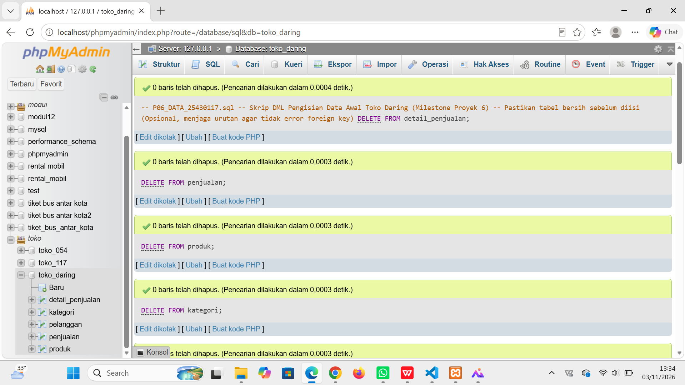
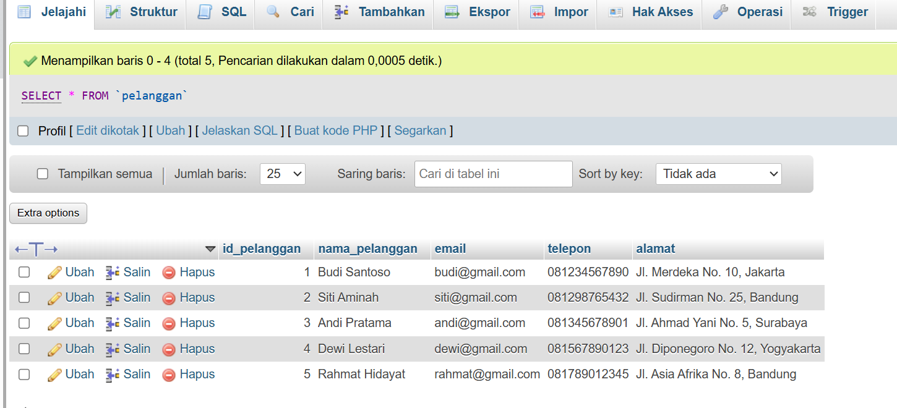

# Laporan Praktikum Basis Data - Pertemuan 06

**Nama:** Helenn Awanda Saumitha
**NIM:** 25430117  
**Kelas:** D
**Tanggal:** 3 November 2026  

## 1. Tujuan Praktikum
1. Menerapkan perintah DML (*Data Manipulation Language*) untuk manipulasi data tingkat lanjut (`INSERT...SELECT`, `UPDATE` multi-tabel, dan `DELETE` kondisional).
2. Memahami teknik pengarsipan data (*data archiving*) tanpa merusak *referential integrity* pada tabel transaksi.
3. Menerapkan fungsi matematika (`ROUND`) dalam pembulatan nilai pada kueri pembaruan data.
4. Menyusun skrip pengisian data otomatis yang *re-runnable* dan 10 skenario pengujian integritas basis data.

## 2. Ringkasan Dasar Teori
* **DML Lanjutan:** Pengoperasian data tidak hanya terbatas pada manipulasi baris tunggal. Teknik seperti `INSERT INTO ... SELECT` memungkinkan penyalinan data massal antar tabel secara efisien.
* **Pengarsipan Data (Archiving):** Proses memindahkan data lama atau nonaktif ke tabel terpisah (`CREATE TABLE ... LIKE`) untuk mengoptimalkan performa tabel utama sekaligus mematuhi kebijakan retensi data.
* **Manipulasi String & Matematika pada Update:** Penggunaan klausa `JOIN` pada perintah `UPDATE` memungkinkan pembaruan kolom berdasarkan kriteria dari tabel relasinya, disertain penyesuaian nilai menggunakan fungsi presisi seperti `ROUND(..., -2)`.

## 3. Hasil Langkah Percobaan

*(Tangkapan layar pengisian data awal dan pembaruan pada basis data)*

### Langkah 3.1 Pengisian Data Awal (INSERT)

* **Tangkapan Layar:**  
    
* **Keterangan:** Eksekusi skrip `p06_data_25430117.sql` berhasil menambahkan data induk (minimal 5 baris) dan transaksi (minimal 10 baris).

### Langkah 3.2 Verifikasi Data Master & Transaksi (SELECT)

* **Tangkapan Layar:**  
    
* **Keterangan:** Menampilkan hasil *query* dari tabel `pelanggan`, `produk`, dan `penjualan` untuk memastikan seluruh baris data terdistribusi dengan benar.

## 4. Jawaban Titik Analisis
1. **Mengapa pemindahan data anggota nonaktif harus menyertakan kondisi `NOT IN (SELECT id_pelanggan FROM penjualan)`?**  
   * *Jawaban:* Karena tabel `penjualan` memiliki relasi *Foreign Key* ke tabel `pelanggan`. Jika anggota yang pernah melakukan transaksi dihapus dari tabel utama tanpa penanganan khusus, dapat terjadi error pelanggaran integritas referensial atau data transaksi menjadi *orphan*.

2. **Bagaimana fungsi `ROUND(..., -2)` bekerja pada pembulatan harga?**  
   * *Jawaban:* Parameter `-2` pada fungsi `ROUND` menginstruksikan DBMS untuk membulatkan nilai numerik ke digit ratusan terdekat (misalnya 15.225 menjadi 15.200, atau 15.260 menjadi 15.300).

## 5. Hasil Latihan dan Modifikasi

### Soal 1: Pengarsipan Anggota Nonaktif Pendaftaran Sebelum 2025

Memindahkan semua anggota berstatus nonaktif sebelum 2025 ke `pelanggan_arsip` dan menghapusnya dari tabel utama:

```sql
-- 1. Buat tabel arsip selaras dengan struktur tabel induk
CREATE TABLE pelanggan_arsip LIKE pelanggan;

-- 2. Salin data anggota nonaktif yang tidak memiliki transaksi
INSERT INTO pelanggan_arsip 
SELECT * FROM pelanggan 
WHERE status = 'nonaktif' 
  AND tanggal_daftar < '2025-01-01'
  AND id_pelanggan NOT IN (
      SELECT DISTINCT id_pelanggan 
      FROM penjualan 
      WHERE id_pelanggan IS NOT NULL
  );

-- 3. Hapus data dari tabel asal
DELETE FROM pelanggan 
WHERE status = 'nonaktif' 
  AND tanggal_daftar < '2025-01-01'
  AND id_pelanggan NOT IN (
      SELECT DISTINCT id_pelanggan 
      FROM penjualan 
      WHERE id_pelanggan IS NOT NULL
  );
```

### Soal 2: Pembaruan Harga Kategori Makanan +5% (Pembulatan Ratusan)

Menarik relasi `kategori` untuk menaikkan harga barang kategori 'Makanan' sebesar 5% dibulatkan ke ratusan terdekat:

```sql
UPDATE produk p
JOIN kategori k ON p.id_kategori = k.id_kategori
SET p.harga = ROUND(p.harga * 1.05, -2)
WHERE k.nama_kategori = 'Makanan';
```

## 6. Tugas Mandiri: Milestone Proyek 6

* Skrip DML dipisahkan dalam berkas `p06_data_25430117.sql`.
* Skenario pengujian integritas (10 skenario uji) didefinisikan dalam berkas `p06_uji_25430117.md`.

## 7. Pembahasan dan Kendala
* **Pembahasan:** Praktikum Modul 6 melatih pemahaman mendalam mengenai DML kompleks. Operasi manipulasi data terbukti tidak hanya berinteraksi dengan satu tabel, melainkan melibatkan tabel relasional lainnya.
* **Kendala:** Saat membuat skrip pengarsipan, opsi `ON DELETE SET NULL` dari Modul 5 perlu diperhatikan agar data histori tidak hilang atau gagal dihapus akibat pembatasan *foreign key constraint*.

## 8. Kesimpulan
1. Manipulasi data DML massal dapat dilakukan secara aman menggunakan `INSERT INTO ... SELECT`.
2. Penggunaan `JOIN` pada perintah `UPDATE` dan fungsi matematika `ROUND` mempermudah pengubahan data bersyarat secara efisien.
3. Aturan integritas referensial harus tetap dipertimbangkan saat melakukan penghapusan data master yang memiliki riwayat transaksi.

## 9. Pernyataan Penggunaan AI
* AI (Gemini) digunakan untuk membantu menyusun skrip DML pengisian data toko daring, query pembulatan matematika `UPDATE`, serta menyelaraskan format laporan Markdown.

## 10. Bukti Git
* **Tautan Repositori:** https://github.com/[username_anda]/praktikum-bd-2026
* **Hash Commit:** `c7d8e9f0123456789abcdef0123456789a1b2c3d`

## Checklist
- [x] Laporan disusun sesuai struktur baku tanpa mengubah urutan bagian.
- [x] Berkas DML `p06_data_25430117.sql` telah memuat data sesuai batasan minimal.
- [x] Tangkapan layar bukti eksekusi dan verifikasi data disajikan dengan path relatif yang benar.
- [x] Perintah `UPDATE` pembulatan dan pengarsipan data sudah teruji.
- [x] Bukti Git telah dilampirkan.