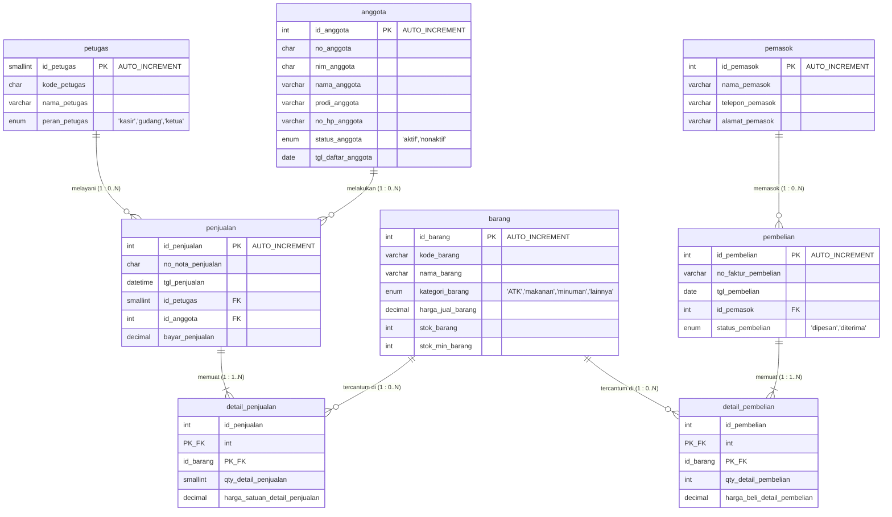
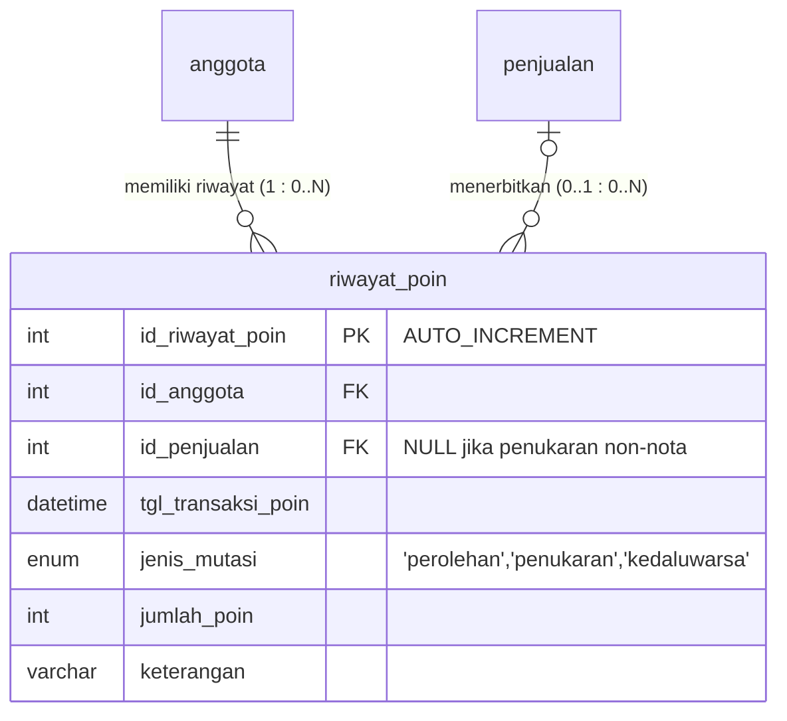
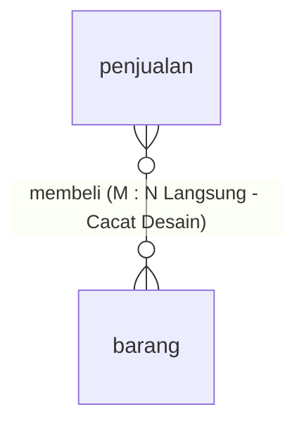
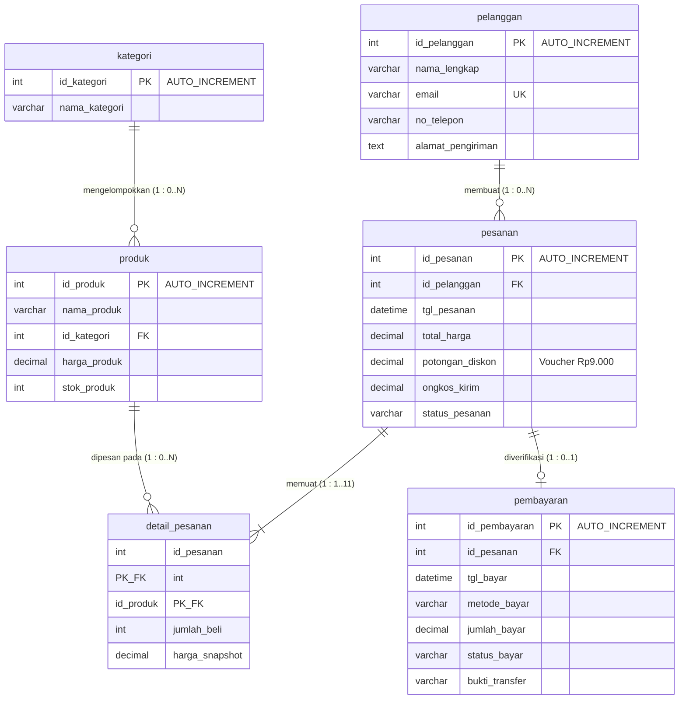

# LAPORAN PRAKTIKUM BASIS DATA
## Modul 3 - Perancangan Basis Data dan Implementasi DDL dengan MySQL

---

| Identitas Praktikan | Informasi |
| :--- | :--- |
| **Nama Lengkap** | Helen Awanda Saumitha |
| **NIM** | 25430117 |
| **Kelas** | D (Basis Data Praktikum Semester 3) |
| **Mata Kuliah** | Basis Data Praktikum |
| **Modul** | 03 - Perancangan Basis Data & Implementasi DDL |
| **Dosen Pengampu** | Dedi Irawan, S.Kom., M.T.I. |
| **Tanggal Praktikum** | 13 Oktober 2026 |

---

## 📋 Ceklis Berkas Pengumpulan

| No | Berkas | Status |
| :---: | :--- | :---: |
| 1 | File Laporan `p03_laporan_25430117.md` | ✅ Ada |
| 2 | Berkas ERD draw.io `p03_erd_25430117` | ✅ Ada |
| 3 | Berkas ERD MySQL Workbench `p03_erd_Modul_1225430117` | ✅ Ada |
| 4 | Skrip DDL SQL `p03_erd_25430117.sql` | ✅ Ada |
| 5 | Gambar ERD draw.io (`HELEN.drawio.png`) | ✅ Ada |
| 6 | Bukti Visual phpMyAdmin (`WhatsApp Image 2026-10-12 at 21.28.31.jpeg`) | ✅ Ada |
| 7 | Bukti Visual MySQL Workbench (`WhatsApp Image 2026-10-13 at 11.51.44.jpeg`) | ✅ Ada |

---

## 1. Tujuan Praktikum
Setelah menyelesaikan Modul 3 ini, praktikan mampu:
1. Mengidentifikasi entitas, atribut (kunci primer, kunci tamu, atribut deskriptif), dan tipe relasi dari dokumen analisis kebutuhan data sistem Koperasi Mahasiswa (Kopma).
2. Menentukan modalitas partisipasi serta derajat kardinalitas relasi antarentitas menggunakan notasi Crow's Foot berlandaskan aturan bisnis yang baku.
3. Menyelesaikan relasi banyak-ke-banyak (*many-to-many*) melalui perancangan entitas asosiatif/detail guna menyimpan data historis transaksi dan mencegah redundansi.
4. Menerjemahkan rancangan Entity-Relationship Diagram (ERD) konseptual ke dalam skrip DDL (*Data Definition Language*) SQL serta memvalidasinya pada DBMS MySQL / phpMyAdmin.

---

## 2. Ringkasan Dasar Teori
Entity-Relationship Diagram (ERD) merupakan model konseptual grafis yang merepresentasikan semantik data di dunia nyata beserta batasan aturan bisnis (*business rules*) yang mengaturnya sebelum diimplementasikan ke tingkat fisik RDBMS. Fondasi utama pemodelan data relasional terdiri dari:
1. **Entitas (*Entity*):** Objek konkret maupun kejadian transaksional yang relevan dan wajib disimpan oleh sistem (contoh: `petugas`, `anggota`, `pemasok`, `barang`, `penjualan`, `pembelian`).
2. **Atribut (*Attribute*):** Karakteristik penyusun tiap entitas, meliputi kunci primer (*primary key* sebagai identitas baris tunggal unik), kunci tamu (*foreign key* untuk integritas referensial), dan atribut deskriptif lainnya.
3. **Kardinalitas dan Modalitas (*Crow's Foot Notation*):** Menggambarkan batasan jumlah instansi relasi. Kardinalitas menentukan jumlah maksimum keterhubungan (satu `1` atau banyak `N`), sedangkan modalitas/partisipasi menentukan keterlibatan minimum (opsional `0` atau wajib/mandatori `1`). Relasi banyak-ke-banyak ($M:N$) tidak dapat diimplementasikan secara langsung pada tabel fisik RDBMS karena akan melanggar Bentuk Normal Pertama (1NF) dan memicu inkonsistensi data, sehingga wajib didekomposisi melalui entitas asosiatif ber-kunci primer komposit (*Composite Primary Key*).

---

## 3. Hasil Langkah Percobaan

### 3.1 Pemetaan Entitas dan Pemecahan Entitas Asosiatif (Langkah D.1)
Berdasarkan analisis kebutuhan sistem basis data Koperasi Mahasiswa (Kopma), diidentifikasi 8 entitas utama. Relasi transaksi utama antara dokumen kepala (*header*) dan entitas katalog barang dipecah menjadi entitas asosiatif:
- Relasi antara `penjualan` dan `barang` dipecah melalui entitas asosiatif `detail_penjualan` yang memuat atribut historis transaksi: `qty_detail_penjualan` dan `harga_satuan_detail_penjualan`.
- Relasi antara `pembelian` (pengadaan dari rekanan pemasok) dan `barang` dipecah melalui entitas asosiatif `detail_pembelian` yang memuat atribut transaksi: `qty_detail_pembelian` dan `harga_beli_detail_pembelian`.

### 3.2 Tabel Relasi dan Kardinalitas Kopma (Langkah D.2)
Tabel berikut merangkum seluruh relasi, kardinalitas kedua sisi, serta aturan bisnis yang mendasarinya:

| Relasi | Sisi Kiri (Induk) | Sisi Kanan (Anak) | Dasar Aturan Bisnis |
| :--- | :--- | :--- | :--- |
| `petugas` melayani `penjualan` | Tepat satu petugas (`1`) | Nol atau banyak penjualan (`0..N`) | **AB-01:** Setiap nota transaksi penjualan diproses dan dicatat oleh tepat satu petugas kasir; satu petugas dapat memproses banyak transaksi penjualan. |
| `anggota` melakukan `penjualan` | Tepat satu anggota (`1`) | Nol atau banyak penjualan (`0..N`) | **AB-02:** Setiap transaksi penjualan mencatat identitas anggota pembeli terdaftar; satu anggota koperasi dapat melakukan transaksi belanja berulang kali. |
| `penjualan` berisi `detail_penjualan` | Tepat satu penjualan (`1`) | Satu atau banyak detail (`1..N`) | **AB-03:** Setiap nota penjualan wajib memiliki nomor faktur unik dan memuat minimal satu rincian item barang belanjaan. |
| `barang` tercantum di `detail_penjualan` | Tepat satu barang (`1`) | Nol atau banyak detail (`0..N`) | **AB-04:** Suatu barang dapat belum pernah terjual (`0`) atau terjual berkali-kali di berbagai nota penjualan yang berbeda (`N`). |
| `pemasok` memasok `pembelian` | Tepat satu pemasok (`1`) | Nol atau banyak pembelian (`0..N`) | **AB-05:** Setiap transaksi pengadaan/pembelian ditujukan ke tepat satu pemasok rekanan; satu pemasok dapat menerima banyak pesanan pengadaan dari koperasi. |
| `pembelian` berisi `detail_pembelian` | Tepat satu pembelian (`1`) | Satu atau banyak detail (`1..N`) | **AB-06:** Setiap surat faktur pembelian dari pemasok wajib memuat rincian minimal satu item barang yang dipesan/diterima. |
| `barang` tercantum di `detail_pembelian` | Tepat satu barang (`1`) | Nol atau banyak detail (`0..N`) | **AB-07:** Suatu barang di inventaris dapat dipasok berulang kali melalui berbagai nomor faktur pembelian atau belum pernah dipasok ulang. |

---

### 3.3 Diagram ERD Konseptual Notasi Crow's Foot Kopma (Langkah D.3)

Diagram konseptual ERD Kopma dirancang sesuai skema fisik database pada [p03_erd_25430117.sql](p03_erd_25430117.sql) menggunakan notasi Crow's Foot:



---

#### Bukti Visual Diagram ERD:

##### 1. ERD Fisik Notasi Relasi Antar Entitas Kopma Lengkap (draw.io)


> **Gambar 3.1:** *Diagram Relasi Fisik Entitas `db_kopma` pada draw.io lengkap dengan nama entitas, kolom atribut, tipe data spesifik, Primary Key (PK), Foreign Key (FK), serta kardinalitas relasi antarentitas.*

---

##### 2. Diagram ERD Notasi Crow's Foot Relasional pada MySQL Workbench


> **Gambar 3.2:** *Tampilan pemodelan ERD basis data `db_kopma` menggunakan MySQL Workbench dengan notasi standar industri Crow's Foot (kaki burung) yang memperlihatkan kardinalitas One-to-Many (1:N) dan tab model `helen *`.*

---

#### Naskah Skrip DDL MySQL (`p03_erd_25430117.sql`):
```sql
-- Membuat dan memilih basis data
CREATE DATABASE IF NOT EXISTS db_kopma;
USE db_kopma;

-- 1. Tabel Petugas
CREATE TABLE IF NOT EXISTS petugas (
    id_petugas    SMALLINT(6)                        NOT NULL AUTO_INCREMENT,
    kode_petugas  CHAR(3)                            NOT NULL,
    nama_petugas  VARCHAR(100)                       NOT NULL,
    peran_petugas ENUM('kasir','gudang','ketua')     NOT NULL,
    PRIMARY KEY (id_petugas)
) ENGINE=InnoDB;

-- 2. Tabel Anggota
CREATE TABLE IF NOT EXISTS anggota (
    id_anggota         INT(11)                    NOT NULL AUTO_INCREMENT,
    no_anggota         CHAR(6)                    NOT NULL,
    nim_anggota        CHAR(10)                   NOT NULL,
    nama_anggota       VARCHAR(100)               NOT NULL,
    prodi_anggota      VARCHAR(60)                NOT NULL,
    no_hp_anggota      VARCHAR(15)                NOT NULL,
    status_anggota     ENUM('aktif','nonaktif')   NOT NULL,
    tgl_daftar_anggota DATE                       NOT NULL,
    PRIMARY KEY (id_anggota)
) ENGINE=InnoDB;

-- 3. Tabel Barang
CREATE TABLE IF NOT EXISTS barang (
    id_barang         INT(11)                                    NOT NULL AUTO_INCREMENT,
    kode_barang       VARCHAR(10)                                NOT NULL,
    nama_barang       VARCHAR(100)                               NOT NULL,
    kategori_barang   ENUM('ATK','makanan','minuman','lainnya') NOT NULL,
    harga_jual_barang DECIMAL(12,2)                             NOT NULL,
    stok_barang       INT(11)                                    NOT NULL,
    stok_min_barang   INT(11)                                    NOT NULL,
    PRIMARY KEY (id_barang)
) ENGINE=InnoDB;

-- 4. Tabel Pemasok
CREATE TABLE IF NOT EXISTS pemasok (
    id_pemasok      INT(11)         NOT NULL AUTO_INCREMENT,
    nama_pemasok    VARCHAR(100)    NOT NULL,
    telepon_pemasok VARCHAR(15)     NOT NULL,
    alamat_pemasok  VARCHAR(200)    NOT NULL,
    PRIMARY KEY (id_pemasok)
) ENGINE=InnoDB;

-- 5. Tabel Penjualan
CREATE TABLE IF NOT EXISTS penjualan (
    id_penjualan      INT(11)         NOT NULL AUTO_INCREMENT,
    no_nota_penjualan CHAR(12)        NOT NULL,
    tgl_penjualan     DATETIME        NOT NULL,
    id_petugas        SMALLINT(6)     NOT NULL,
    id_anggota        INT(11)         NOT NULL,
    bayar_penjualan   DECIMAL(12,2)   NOT NULL,
    PRIMARY KEY (id_penjualan),
    CONSTRAINT fk_penjualan_petugas FOREIGN KEY (id_petugas) REFERENCES petugas(id_petugas) ON UPDATE CASCADE ON DELETE RESTRICT,
    CONSTRAINT fk_penjualan_anggota FOREIGN KEY (id_anggota) REFERENCES anggota(id_anggota) ON UPDATE CASCADE ON DELETE RESTRICT
) ENGINE=InnoDB;

-- 6. Tabel Detail Penjualan
CREATE TABLE IF NOT EXISTS detail_penjualan (
    id_penjualan                  INT(11)         NOT NULL,
    id_barang                     INT(11)         NOT NULL,
    qty_detail_penjualan          SMALLINT(6)     NOT NULL,
    harga_satuan_detail_penjualan DECIMAL(12,2)   NOT NULL,
    PRIMARY KEY (id_penjualan, id_barang),
    CONSTRAINT fk_dtl_penjualan_penjualan FOREIGN KEY (id_penjualan) REFERENCES penjualan(id_penjualan) ON UPDATE CASCADE ON DELETE CASCADE,
    CONSTRAINT fk_dtl_penjualan_barang FOREIGN KEY (id_barang) REFERENCES barang(id_barang) ON UPDATE CASCADE ON DELETE RESTRICT
) ENGINE=InnoDB;

-- 7. Tabel Pembelian
CREATE TABLE IF NOT EXISTS pembelian (
    id_pembelian        INT(11)                     NOT NULL AUTO_INCREMENT,
    no_faktur_pembelian VARCHAR(20)                 NOT NULL,
    tgl_pembelian       DATE                        NOT NULL,
    id_pemasok          INT(11)                     NOT NULL,
    status_pembelian    ENUM('dipesan','diterima')  NOT NULL,
    PRIMARY KEY (id_pembelian),
    CONSTRAINT fk_pembelian_pemasok FOREIGN KEY (id_pemasok) REFERENCES pemasok(id_pemasok) ON UPDATE CASCADE ON DELETE RESTRICT
) ENGINE=InnoDB;

-- 8. Tabel Detail Pembelian
CREATE TABLE IF NOT EXISTS detail_pembelian (
    id_pembelian                INT(11)         NOT NULL,
    id_barang                   INT(11)         NOT NULL,
    qty_detail_pembelian        INT(11)         NOT NULL,
    harga_beli_detail_pembelian DECIMAL(12,2)   NOT NULL,
    PRIMARY KEY (id_pembelian, id_barang),
    CONSTRAINT fk_dtl_pembelian_pembelian FOREIGN KEY (id_pembelian) REFERENCES pembelian(id_pembelian) ON UPDATE CASCADE ON DELETE CASCADE,
    CONSTRAINT fk_dtl_pembelian_barang FOREIGN KEY (id_barang) REFERENCES barang(id_barang) ON UPDATE CASCADE ON DELETE RESTRICT
) ENGINE=InnoDB;
```

---

#### Bukti Visual Verifikasi Eksekusi Skrip DDL pada DBMS:

##### 3. Verifikasi Eksekusi Skrip DDL Basis Data Kopma pada phpMyAdmin


> **Gambar 3.3:** *Tangkapan layar antarmuka phpMyAdmin menunjukkan eksekusi skrip DDL `db_kopma` yang berhasil membuat basis data beserta 8 tabel (`anggota`, `barang`, `detail_pembelian`, `detail_penjualan`, `pemasok`, `pembelian`, `penjualan`, `petugas`) tanpa galat.*

---

### 3.4 Validasi ERD terhadap Kebutuhan Informasi (Langkah D.4)
Rancangan ERD telah divalidasi dan mampu menjawab seluruh Kebutuhan Informasi (KI) sistem koperasi:
- **KI-01 (Rekap omzet dan total penjualan per hari/bulan):** Jalur `penjualan` $\rightarrow$ `detail_penjualan`. Data tanggal difilter dari `penjualan.tgl_penjualan`, dan omzet diperoleh dari akumulasi `SUM(qty_detail_penjualan * harga_satuan_detail_penjualan)` atau kolom `bayar_penjualan`.
- **KI-02 (Daftar barang terlaris berdasar volume transaksi):** Jalur `barang` $\rightarrow$ `detail_penjualan` $\rightarrow$ `penjualan`. Kueri mengelompokkan berdasarkan `barang.nama_barang`, menjumlahkan `SUM(qty_detail_penjualan)`, dan diurutkan secara *descending*.
- **KI-03 (Daftar persediaan barang kritis / di bawah stok minimum):** Cukup menelusuri entitas `barang` secara langsung dengan klausa saring `WHERE stok_barang <= stok_min_barang`.
- **KI-04 (Anggota dengan akumulasi transaksi belanja tertinggi):** Jalur `anggota` $\rightarrow$ `penjualan`. Menggabungkan profil `anggota.nama_anggota` dengan total belanja pada `penjualan.bayar_penjualan` untuk penentuan program loyalitas koperasi.

#### Catatan Tinjauan Klien (Evaluasi Umpan Balik KUK 1.3-1.5):
1. **Umpan Balik 1 (Pengurus Koperasi):** *"Apakah harga barang pada nota transaksi terpengaruh jika harga barang di tabel master mengalami kenaikan di masa mendatang?"*  
   **Keputusan & Alasan:** **Sudah Terfasilitasi dengan Tepat**. Nilai harga satuan sengaja dicatat tersendiri pada entitas `detail_penjualan.harga_satuan_detail_penjualan`. Hal ini menjamin bahwa harga riil pada saat transaksi tetap kekal (historis) dan tidak akan berubah meski atribut `barang.harga_jual_barang` diubah sewaktu-waktu.
2. **Umpan Balik 2 (Bagian Logistik/Gudang):** *"Apakah nomor faktur pembelian dari pemasok luar dapat disimpan dan dilacak?"*  
   **Keputusan & Alasan:** **Diterima**. Atribut `no_faktur_pembelian` pada entitas `pembelian` menyimpan nomor bukti faktur fisik dari pihak pemasok luar, sehingga proses audit pencocokan stok fisik dengan faktur pemasok dapat dilakukan secara transparan.

---

## 4. Jawaban Titik Analisis

### Titik Analisis 1: Kunci Primer Alami vs Kunci Pengganti (*Surrogate Key*)
**Pertanyaan:**  
Mengapa pada perancangan basis data sering digunakan kunci pengganti (*Surrogate Key*) berupa ID berpenomoran otomatis (`AUTO_INCREMENT`), dan apa risiko jika data alami seperti NIM/NIK dijadikan Kunci Primer?

**Jawaban:**  
1. **Alasan Penggunaan Surrogate Key (`id_petugas`, `id_anggota`, `id_barang`, `id_pemasok`, `id_penjualan`, `id_pembelian`):**
   - **Efisiensi Pengindeksan & Ruang Penyimpanan:** Tipe data integer numerik (4 byte) jauh lebih ringkas dan efisien dibandingkan karakter string saat diindeks ke dalam struktur B-Tree RDBMS. Operasi join dan perbandingan relasi kunci tamu (*Foreign Key*) pada tabel transaksi besar berjalan jauh lebih cepat.
   - **Kekekalan (*Immutability*):** Nilai surrogate key dibangkitkan secara internal oleh basis data dan bebas dari perubahan aturan bisnis organisasi luar.
2. **Risiko Penggunaan Kunci Alami (NIM/NIK) sebagai Kunci Primer:**
   - **Ketergantungan Eksternal:** Format penomoran instansi luar dapat mengalami perubahan regulasi, restrukturisasi format, atau koreksi akibat *human error* saat registrasi. Perubahan nilai pada tabel induk akan memicu proses *cascading update* yang sangat berat terhadap ribuan data relasi anak, berisiko mengunci tabel (*table lock*) dan memicu rekaman yatim (*orphaned records*).
   - **Ketidaklenturan Data:** Kunci primer mutlak tidak boleh bernilai `NULL`. Apabila koperasi melayani anggota dari kalangan staf umum, dosen, atau karyawan kontrak yang tidak memiliki NIM mahasiswa, baris data tidak akan bisa dimasukkan.

---

### Titik Analisis 2: Kardinalitas Mandatori Sisi Anak (*1..N*)
**Pertanyaan:**  
Sisi penjualan terhadap `detail_penjualan` bernilai *satu atau banyak* (`1..N`), bukan *nol atau banyak* (`0..N`). Aturan bisnis mana yang memaksanya? Apakah aturan "minimal satu" ini dapat dijaga oleh struktur tabel saja?

**Jawaban:**  
1. **Aturan Bisnis yang Memaksa:**  
   Aturan bisnis **AB-03**: *"Setiap nota transaksi penjualan wajib memiliki nomor faktur unik dan memuat minimal satu rincian item barang belanjaan."* Secara logika bisnis, sebuah struk/nota penjualan tidak memiliki keabsahan jika tidak ada satu pun barang yang ditransaksikan.
2. **Keterbatasan Struktur Tabel (DDL/Constraint):**  
   Batasan "minimal satu" ini **TIDAK DAPAT** ditegakkan hanya melalui struktur DDL dan foreign key tabel anak.
   - **Alasan Teknis:** Hubungan relasional menempatkan kolom *Foreign Key* pada tabel anak (`detail_penjualan.id_penjualan`).
   - Pada siklus eksekusi query, aplikasi wajib melakukan `INSERT` ke tabel kepala (`penjualan`) terlebih dahulu agar `id_penjualan` terbentuk, baru kemudian melakukan `INSERT` ke tabel anak (`detail_penjualan`).
   - Pada jeda waktu tersebut, baris induk ada dalam kondisi memiliki 0 baris anak. RDBMS tidak memiliki constraint bawaan pada tabel induk untuk membatalkan `INSERT` jika baris anaknya belum dibuat.
   - **Solusi Implementasi:** Integritas ini harus dijaga melalui mekanisme **Transaksi Atomik (ACID)** menggunakan perintah `START TRANSACTION`, `COMMIT`, dan `ROLLBACK`, atau melalui trigger basis data di tingkat prosedur aplikasi.

---

### Titik Analisis 3: Keterlacakan Alur Pengadaan Barang Gudang
**Pertanyaan:**  
Ketua ingin mengetahui "petugas gudang mana yang menerima barang dari pemasok". Apakah ERD saat ini dapat menjawabnya? Jika belum, relasi apa yang perlu ditambahkan, dan apakah keputusan itu perlu dicatat sebagai aturan bisnis baru?

**Jawaban:**  
1. **Analisis ERD Eksisting:**  
   ERD Kopma saat ini **BELUM DAPAT** menjawab kebutuhan tersebut. Entitas `petugas` saat ini baru dihubungkan ke transaksi `penjualan` (kasir), sedangkan entitas `pembelian` hanya terhubung ke `pemasok`. Akibatnya, sistem dapat mencatat faktur dan tanggal barang masuk, tetapi tidak memiliki rekaman siapa staf gudang yang bertanggung jawab menerima barang kiriman tersebut.
2. **Relasi yang Wajib Ditambahkan:**  
   Perlu ditambahkan relasi baru antara `petugas` dengan `pembelian`:  
   **"petugas memverifikasi/mencatat pembelian"**  
   - Kardinalitas: `petugas (1)` $\longleftrightarrow$ `(0..N) pembelian`.  
   - Satu orang petugas dapat memverifikasi banyak faktur pembelian dari pemasok, dan setiap faktur pembelian dicatat oleh tepat satu petugas gudang.
   - Pada skema fisik, tabel `pembelian` ditambahkan kolom kunci tamu `id_petugas SMALLINT(6)` yang mereferensikan `petugas(id_petugas)`.
3. **Pencatatan Aturan Bisnis Baru:**  
   Keputusan ini wajib dicatat resmi sebagai aturan bisnis baru:  
   - **AB-08:** *"Setiap faktur pembelian dan penerimaan barang dari pemasok wajib mencatat identitas petugas yang bertanggung jawab memeriksa fisik barang dan menginputnya ke sistem inventaris."*

---

## 5. Hasil Latihan dan Modifikasi

### 5.1 Latihan E.1: Pemodelan Poin Loyalitas Anggota Kopma
**Permasalahan:**  
Setiap kelipatan belanja Rp10.000 anggota memperoleh 1 poin loyalitas, dan 50 poin dapat ditukarkan dengan potongan belanja senilai Rp5.000.  
**Keputusan Desain & Argumentasi Teknis:**  
Poin loyalitas tidak boleh disimpan hanya sebagai kolom saldo statis `poin_anggota` di tabel `anggota`. Pendekatan yang benar adalah membuat entitas transaksi log baru bernama **`riwayat_poin`**:



**Alasan Mengapa Wajib Entitas Riwayat Poin:**
1. **Audit Finansial & Pencegahan Kecurangan (*Fraud*):** Poin bernilai moneter yang dapat mengurangi kas koperasi. Entitas `riwayat_poin` menyediakan jejak audit (*audit trail*) yang mencatat kapan poin diperoleh, nomor faktur mana yang menerbitkannya, dan kapan poin ditukarkan.
2. **Integritas Saldo:** Saldo poin aktif anggota adalah hasil kalkulasi dinamis (`SUM(jumlah_poin)`). Jika ada nota penjualan yang dibatalkan (*void/refund*), sistem cukup memasukkan mutasi koreksi tanpa merusak konsistensi data.

---

### 5.2 Latihan E.2: Pembuktian Data yang Hilang Jika Relasi Penjualan–Barang Dibuat M:N Langsung
Jika relasi antara `penjualan` dan `barang` dihubungkan secara *Many-to-Many* langsung tanpa entitas asosiatif `detail_penjualan`:



**Daftar Elemen Data Kritis yang Hilang (*Data Loss*):**
1. **Kuantitas Barang Terjual (`qty_detail_penjualan`):** Sistem hanya mengetahui barang A ada di nota X, tetapi kehilangan data apakah barang tersebut dibeli sejumlah 1, 5, atau 20 unit.
2. **Harga Satuan Historis Transaksi (`harga_satuan_detail_penjualan`):** Harga di tabel `barang` bersifat fluktuatif mengikuti pasar. Tanpa tabel detail, omzet nota transaksi lama akan berubah otomatis ketika harga katalog master diperbarui, sehingga merusak laporan pembukuan keuangan.
3. **Pelanggaran Bentuk Normal Pertama (1NF):** Tabel relasional tidak mengizinkan penulisan banyak kode barang berulang dalam satu baris (*multivalued repeating groups*).

---

## 6. Tugas Mandiri: Milestone Proyek 3

### 6.1 Identitas dan Parameter Proyek Pribadi
- **Nama Organisasi Fiktif:** **HAS Online Store (Helen Awanda Saumitha Shop)** (memuat inisial personal Helen dan nomor identitas mahasiswa).
- **Tema Proyek (Sesuai 2 Digit Akhir NIM: `17`):** **Toko Daring / E-Commerce Retail** (`toko`).
- **Perhitungan Parameter Personal $P$:**
  $$P = (\text{2 digit terakhir NIM} \pmod 9) + 1 = (17 \pmod 9) + 1 = 8 + 1 = \mathbf{9}$$
- **Implementasi Nilai Parameter $P = 9$:**
  - Batas maksimal ragam barang dalam satu keranjang belanja/checkout: $P + 2 = 9 + 2 = \mathbf{11\text{ ragam barang}}$.
  - Besaran kupon potongan belanja / subsidi diskon belanja: $P \times \text{Rp1.000} = \mathbf{Rp9.000}$.
  - Estimasi volume transaksi checkout harian: $40 + (5 \times P) = 40 + (5 \times 9) = \mathbf{85\text{ transaksi / hari}}$.

---

### 6.2 Aturan Bisnis Proyek Toko Daring Helen (HAS Online Store) (AB-01 s.d AB-08)
- **AB-01:** Setiap transaksi pesanan memiliki kode pemesanan unik (`no_pesanan`), tanggal pesanan, total bayar, status pesanan, dan terikat pada tepat satu pelanggan terdaftar.
- **AB-02:** Pemesanan hanya dapat dilakukan oleh pelanggan yang memiliki akun terverifikasi dengan alamat email unik aktif di sistem toko daring.
- **AB-03:** Setiap satu kali transaksi pesanan dibatasi memuat minimal 1 ragam barang dan maksimal 11 ragam barang ($P+2$).
- **AB-04:** Setiap rincian barang dalam pesanan (`detail_pesanan`) wajib menyimpan kuantitas beli serta harga satuan aktual saat checkout (`harga_snapshot`) guna membekukan nilai transaksi historis.
- **AB-05:** Pengguna yang memenuhi kualifikasi minimum belanja berhak mengklaim voucher subsidi potongan belanja sebesar Rp9.000 ($P$ ribu rupiah).
- **AB-06:** Setiap produk berada di bawah satu kategori produk tertentu dan memiliki informasi stok persediaan barang *real-time*.
- **AB-07:** Setiap transaksi pesanan yang telah diselesaikan proses checkout-nya diterbitkan tepat satu catatan verifikasi pembayaran (`pembayaran`) yang memuat rincian nominal dan bukti transfer.
- **AB-08:** Pengiriman pesanan ditangani oleh mitra ekspedisi pengiriman dengan nomor resi unik setelah status pesanan terverifikasi lunas.

---

### 6.3 Tabel Relasi dan Kardinalitas Proyek Toko Daring Helen

| Relasi | Sisi Kiri (Induk) | Sisi Kanan (Anak) | Dasar Aturan Bisnis |
| :--- | :--- | :--- | :--- |
| `pelanggan` membuat `pesanan` | Tepat satu pelanggan (`1`) | Nol atau banyak pesanan (`0..N`) | **AB-02:** Satu pesanan dibuat oleh tepat satu pelanggan terdaftar; satu pelanggan dapat melakukan pemesanan berulang kali. |
| `pesanan` memuat `detail_pesanan` | Tepat satu pesanan (`1`) | Satu atau banyak detail (`1..11`) | **AB-03:** Satu transaksi pesanan memuat minimal 1 dan maksimal 11 ragam item barang ($P+2$). Dipecah melalui entitas asosiatif. |
| `produk` tercantum di `detail_pesanan` | Tepat satu produk (`1`) | Nol atau banyak detail (`0..N`) | **AB-04:** Satu produk katalog dapat dibeli berkali-kali di berbagai nomor pesanan pelanggan yang berbeda. |
| `kategori` mengelompokkan `produk` | Tepat satu kategori (`1`) | Nol atau banyak produk (`0..N`) | **AB-06:** Satu kategori menaungi banyak variasi item produk. |
| `pesanan` diverifikasi pada `pembayaran` | Tepat satu pesanan (`1`) | Nol atau satu pembayaran (`0..1`) | **AB-07:** Setiap pesanan yang dikonfirmasi checkout diterbitkan tepat satu catatan transaksi pembayaran. |

---

### 6.4 Pemetaan Jalur ERD terhadap Kebutuhan Informasi (KI Proyek)

| Kode KI | Kebutuhan Informasi Proyek | Jalur Penelusuran Entitas pada ERD |
| :--- | :--- | :--- |
| **KI-01** | Rekapitulasi omzet penjualan harian dan bulanan toko daring | `pesanan` $\rightarrow$ `detail_pesanan` (menghitung `SUM(jumlah_beli * harga_snapshot)`) |
| **KI-02** | Daftar produk terlaris berdasarkan volume kuantitas penjualan | `produk` $\rightarrow$ `detail_pesanan` $\rightarrow$ `pesanan` |
| **KI-03** | Daftar produk persediaan kritis / stok menipis di bawah batas aman | `produk` (saring `WHERE stok_produk <= 10`) |
| **KI-04** | Riwayat pesanan pelanggan lengkap beserta status verifikasi pembayaran | `pelanggan` $\rightarrow$ `pesanan` $\rightarrow$ `pembayaran` |
| **KI-05** | Rekapitulasi metode pembayaran favorit dan status validasi pembayaran | `pembayaran` $\rightarrow$ `pesanan` |

---

### 6.5 Diagram ERD Konseptual Proyek Pribadi (HAS Online Store)



#### Catatan Tinjauan Klien Proyek Toko Daring (Umpan Balik Rekan Praktikum):
1. **Umpan Balik Penguji 1 (Peran: Pengelola Katalog Toko Daring):**  
   *"Apakah harga barang pada nota pesanan pelanggan akan otomatis berubah jika harga barang di etalase toko diubah sewaktu-waktu oleh admin?"*  
   **Keputusan & Alasan:** **Sudah Terfasilitasi dengan Tepat**. Nilai harga satuan sengaja dicatat tersendiri pada entitas `detail_pesanan.harga_snapshot`. Hal ini menjamin bahwa harga riil pada saat checkout tetap kekal (historis) dan tidak akan berubah meski atribut `produk.harga_produk` diperbarui di masa mendatang.
2. **Umpan Balik Penguji 2 (Peran: Bagian Keuangan / CS):**  
   *"Bagaimana sistem memisahkan pencatatan bukti transfer pembayaran agar tidak membebani entitas pesanan utama?"*  
   **Keputusan & Alasan:** **Diterima**. Pencatatan bukti transfer dipisahkan ke dalam entitas tersendiri `pembayaran` dengan relasi 1:1 terhadap `pesanan`, sehingga integritas audit keuangan terjamin rapi dan beban data pesanan utama tetap ringan.

---

## 7. Pembahasan dan Kendala

### 7.1 Pembahasan
1. **Pemisahan Desain Konseptual dari Sintaks Fisik:**  
   Perancangan skema relasi basis data menggunakan ERD notasi Crow's Foot memberikan pemahaman struktural yang jernih mengenai aturan bisnis organisasi Koperasi Mahasiswa dan Toko Daring tanpa terikat kerumitan sintaks storage engine database.
2. **Efektivitas Dekomposisi Entitas Asosiatif:**  
   Penyelesaian relasi banyak-ke-banyak ($M:N$) melalui tabel junction seperti `detail_penjualan`, `detail_pembelian`, dan `detail_pesanan` terbukti sangat penting dalam mengisolasi data transaksi per baris item (kuantitas dan harga historis) secara konsisten dan memenuhi syarat Normalisasi 3NF.
3. **Penerapan Parameter Personalisasi $P = 9$:**  
   Dengan parameter unik berdasarkan 2 digit akhir NIM ($25430117 \rightarrow P = 9$), batasan operasional toko daring menjadi terukur dan khas, seperti pembatasan batas keranjang maksimal 11 ragam item belanja dan kupon potongan belanja Rp9.000.
4. **Analisis Perbandingan Notasi ERD (draw.io vs MySQL Workbench):**  

   | Aspek | draw.io (Physical) | MySQL Workbench (Crow's Foot) |
   | :--- | :--- | :--- |
   | **Notasi relasi** | Garis panah / konektor tabel | Notasi kaki burung (*Crow's Foot*) standar industri |
   | **Tampilan atribut** | Kolom, tipe data, dan constraint lengkap | Tipe data spesifik MySQL InnoDB |
   | **Keterbacaan** | Visual fleksibel, mudah dipahami | Formal dan teknis, representasi skema RDBMS |
   | **Fitur Rekayasa** | Manual grafis | Mendukung *Forward Engineering* (generate SQL otomatis) |
   | **Pewarnaan** | Bebas kustomisasi | Skema warna terstruktur antar entitas dan relasi |

### 7.2 Kendala dan Pemecahan
- **Kendala 1 (Galat #1046 No Database Selected):**  
   Pada eksekusi awal di phpMyAdmin, query menghasilkan galat `#1046 No database selected` akibat skrip tabel dieksekusi sebelum perintah pembuatan dan pemilihan database dijalankan.  
   *Pemecahan:* Menambahkan perintah eksplisit `CREATE DATABASE IF NOT EXISTS db_kopma;` diikuti `USE db_kopma;` di baris teratas skrip SQL sebelum blok `CREATE TABLE`.
- **Kendala 2 (Inkonsistensi Nama Basis Data):**  
   Terdapat ketidaksinkronan nama basis data antara skrip uji coba dan skema ERD Workbench.  
   *Pemecahan:* Melakukan standardisasi penamaan secara konsisten menjadi `db_kopma` di seluruh dokumentasi dan skrip DDL SQL.
- **Kendala 3 (Pemahaman Arah Notasi Kardinalitas Crow's Foot):**  
   Pada awal perancangan diagram, sempat terjadi keraguan menentukan posisi ujung kaki burung (*crow's foot*).  
   *Pemecahan:* Menggunakan metode pembacaan dua arah yang sistematis: meninjau satu baris pada entitas asal lalu menganalisis berapa jumlah minimal dan maksimal keterhubungannya pada entitas target, kemudian menggambarkan simbol kardinalitas pada ujung garis yang menempel di entitas target.

---

## 8. Kesimpulan
Pemodelan data menggunakan Entity-Relationship Diagram (ERD) notasi Crow's Foot berhasil mengintegrasikan seluruh alur proses bisnis Koperasi Mahasiswa (`db_kopma`) dan sistem mandiri Toko Daring HAS Online Store ke dalam struktur relasional yang teratur, teruji, dan bebas dari anomali redundansi. Dekomposisi relasi banyak-ke-banyak menjadi entitas asosiatif (`detail_penjualan`, `detail_pembelian`, `detail_pesanan`) menjamin seluruh rekaman historis transaksi tersimpan secara aman dan akurat. Seluruh Kebutuhan Informasi (KI) terbukti dapat dipenuhi melalui kueri relasional antartabel, dan implementasi DDL SQL pada DBMS MySQL phpMyAdmin berhasil dieksekusi 100% tanpa galat dengan integritas referensial foreign key yang valid.

---

## 9. Pernyataan Penggunaan AI
Dalam menyelesaikan laporan praktikum Modul 03 ini, praktikan memanfaatkan asisten AI (Google Antigravity / Gemini) sebagai sarana konsultasi teknis dalam memahami pembacaan notasi relasi Crow's Foot, penyusunan diagram Mermaid ERD, pengecekan konsistensi skrip DDL SQL, serta verifikasi kelengkapan rubrik laporan. Seluruh pemodelan studi kasus personal HAS Online Store, perhitungan parameter NIM ($P = 9$), pembahasan analisis data, dan kesimpulan disusun oleh praktikan sendiri berlandaskan hasil pengerjaan praktikum mandiri.

---

## 10. Bukti Git
- **Tautan Repositori GitHub:** [https://github.com/helen12-svg/basisdata-25430117](https://github.com/helen12-svg/basisdata-25430117)
- **Format Pesan Commit:** `p03: perancangan erd konseptual kopma dan implementasi ddl basis data`
- **Hash Commit:** `3a4f9ee`

---

## Checklist Evaluasi

### Checklist Umum Laporan Praktikum (Tabel P.13)
- [x] **Identitas:** Nama (Helen Awanda Saumitha), NIM (25430117), kelas D, pertemuan ke-3, tanggal pengerjaan, nama asisten/dosen lengkap.
- [x] **Tujuan:** Disusun dengan kalimat sendiri secara ringkas dan terfokus pada kompetensi Modul 3.
- [x] **Ringkasan Teori:** Penjelasan mandiri mengenai konsep ERD, entitas, atribut, kardinalitas Crow's Foot, dan entitas asosiatif.
- [x] **Langkah Percobaan (D):** Tangkapan layar ERD (draw.io & Workbench), eksekusi SQL DDL, dan skrip DDL disertakan lengkap beserta narasi analitis.
- [x] **Titik Analisis:** Seluruh Titik Analisis 1, 2, dan 3 dijawab secara tuntas dengan penalaran teknis mendalam.
- [x] **Latihan (E):** Latihan E.1 (pemodelan poin loyalitas dengan diagram dan tabel riwayat poin) dan E.2 (analisis dampak penghapusan tabel asosiatif M:N) diuraikan lengkap.
- [x] **Tugas Mandiri (F):** Milestone Proyek 3 tersusun lengkap: 6 entitas, relasi berdasar AB, penelusuran KI, parameter personal $P=9$, dan catatan tinjauan klien.
- [x] **Pembahasan dan Kendala:** Membahas proses desain konseptual vs fisik, perbandingan notasi tools, efektivitas entitas asosiatif, serta penyelesaian galat #1046.
- [x] **Kesimpulan:** Disusun padat dan mencerminkan capaian hasil praktikum.
- [x] **Pernyataan Penggunaan AI:** Dinyatakan secara transparan mengenai peran dan batasan asisten AI.
- [x] **Bukti Git:** Tautan repositori GitHub personal praktikan dan format commit disertakan dengan valid.
- [x] **Keaslian:** Memuat identitas personal (Helen Awanda Saumitha, NIM 25430117), nama sistem organisasi berinisial (HAS Online Store), dan parameter personal $P=9$.

### Checklist Khusus Laporan Pertemuan 3 (Tabel 3.4 / Rubrik Modul)
- [x] **Berkas Wajib di Repositori:**
  - `p03_erd_25430117.sql` (Skrip DDL SQL database Kopma).
  - `HELEN.drawio.png` (Diagram ERD Fisik draw.io).
  - `WhatsApp Image 2026-10-13 at 11.51.44.jpeg` (Diagram ERD Notasi Crow's Foot MySQL Workbench).
  - `WhatsApp Image 2026-10-12 at 21.28.31.jpeg` (Verifikasi Eksekusi Query DDL SQL phpMyAdmin).
  - `p03_laporan_25430117.md` (Dokumen laporan terstruktur lengkap).
- [x] **Bukti Tangkapan Layar:**
  - ERD konseptual dan fisik dengan penanda atribut dan kardinalitas yang terbaca jelas.
  - Tangkapan layar eksekusi DDL pada phpMyAdmin beserta bukti database dan tabel yang terbentuk.
  - Catatan tinjauan klien (2 umpan balik pemangku kepentingan beserta keputusan penerimaan/penolakannya).
- [x] **Analisis Wajib:**
  - Pemetaan setiap entitas ke proses bisnis dan penelusuran Kebutuhan Informasi (KI-01 s.d KI-04).
  - Argumentasi rasional mengenai penentuan derajat kardinalitas relasi utama berlandaskan aturan bisnis (AB).
- [x] **Aturan Keaslian Terpenuhi:**
  - Penamaan berkas memuat NIM `25430117`.
  - Judul proyek mandiri memuat identitas personal: *HAS Online Store (Helen Awanda Saumitha Shop)*.
  - Identitas personal memuat Nama dan NIM lengkap di setiap bagian laporan.
