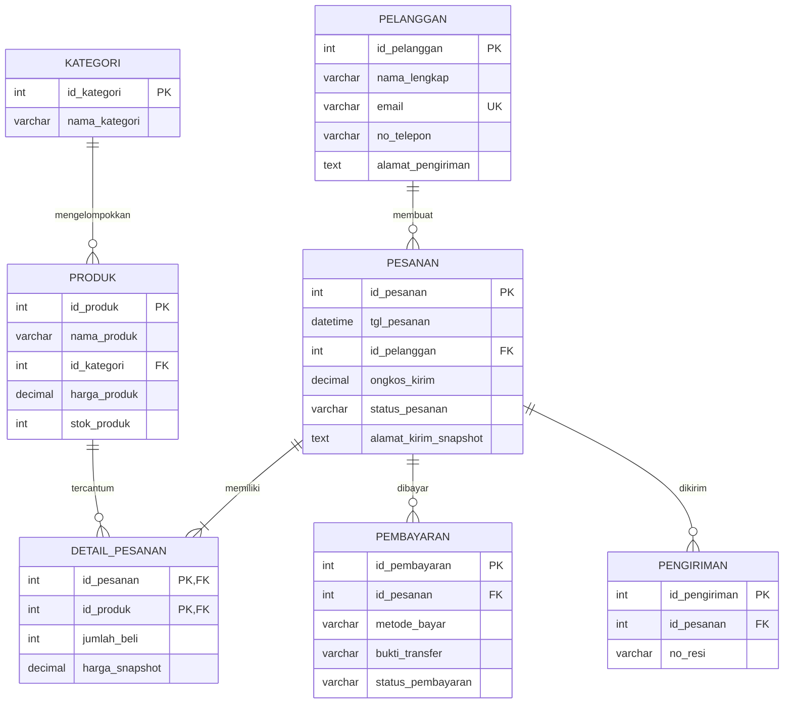

# Normalisasi Basis Data Proyek 04
**Nama Organisasi:** HAS Online Store (Helen Awanda Saumitha Shop)  
**Tema Proyek:** Toko Daring (`toko`)  
**Nama:** Helen Awanda Saumitha  
**NIM:** 25430117  
**Kelas:** D  
**Dokumen sumber:** `p02_kebutuhan_data_25430117.md` — bagian Kamus Data Awal dan Dokumen Sumber Fiktif.

---

## 1. Dokumen Sumber dan Titik Awal UNF

Dokumen sumber yang digunakan adalah **Bukti Pesanan Resmi (Invoice)** HAS Online Store pada bagian 8 dokumen Pertemuan 2.

Contoh data pada invoice:

- Nomor pesanan: `INV/20261006/117`
- Tanggal: 06 Oktober 2026
- Pelanggan: Helen Awanda Saumitha
- Nomor telepon: `0812-3456-7890`
- Alamat kirim: Jl. Metro Lampung No. 117, Kota Metro
- Rincian barang:
  - Kemeja Oversize Cokelat, jumlah 2, harga satuan Rp120.000, subtotal Rp240.000
  - Celana Kulot Hitam, jumlah 1, harga satuan Rp150.000, subtotal Rp150.000
- Subtotal produk: Rp390.000
- Ongkos kirim: Rp20.000
- Total bayar: Rp410.000
- Status pembayaran/metode: LUNAS melalui QRIS

### Bentuk UNF (Unnormalized Form)

Pada bentuk UNF, satu nota memuat data header pesanan dan kelompok rincian barang yang dapat berulang.

`UNF_INVOICE(`  
`id_pesanan, tgl_pesanan, id_pelanggan, nama_lengkap, email, no_telepon, alamat_pengiriman,`  
`{id_produk, nama_produk, nama_kategori, jumlah_beli, harga_snapshot, subtotal_item},`  
`total_harga, ongkos_kirim, total_bayar, status_pesanan, metode_bayar, bukti_transfer, no_resi)`  

`{ ... }` menandakan kelompok rincian barang berulang dalam satu nota. `email`, `nama_kategori`, `bukti_transfer`, dan `no_resi` adalah atribut dari kamus data/kebutuhan proyek; nilai spesifiknya tidak tercantum pada contoh invoice sehingga tidak diisi dengan data rekaan. `id_kategori`, `id_produk`, dan `id_pelanggan` dipakai sebagai pengenal basis data, meskipun invoice cetak menampilkan nama yang mudah dibaca.

---

## 2. Kode Atribut (AB) dan Dependensi Fungsional

Kode AB di bawah ini adalah kode atribut yang dipakai untuk merujuk atribut secara ringkas dalam analisis dependensi.

| Kode AB | Nama atribut | Keterangan |
|---|---|---|
| A01 | `id_pesanan` | Kunci pesanan |
| A02 | `tgl_pesanan` | Tanggal/waktu pesanan |
| A03 | `id_pelanggan` | Kunci pelanggan |
| A04 | `nama_lengkap` | Nama pelanggan |
| A05 | `email` | Email pelanggan, unik menurut BR-01 |
| A06 | `no_telepon` | Nomor telepon pelanggan |
| A07 | `alamat_pengiriman` | Alamat pada profil pelanggan menurut kamus data awal |
| A08 | `id_produk` | Kunci produk |
| A09 | `nama_produk` | Nama produk |
| A10 | `id_kategori` | Kunci kategori |
| A11 | `nama_kategori` | Nama kategori |
| A12 | `harga_produk` | Harga produk saat ini |
| A13 | `stok_produk` | Stok produk saat ini |
| A14 | `jumlah_beli` | Kuantitas produk pada detail pesanan |
| A15 | `harga_snapshot` | Harga satuan historis ketika checkout |
| A16 | `subtotal_item` | Nilai turunan: jumlah beli × harga snapshot |
| A17 | `total_harga` | Subtotal seluruh item produk pada pesanan |
| A18 | `ongkos_kirim` | Ongkos kirim pesanan |
| A19 | `total_bayar` | Nilai turunan: total harga + ongkos kirim |
| A20 | `status_pesanan` | Status pesanan |
| A21 | `metode_bayar` | Metode pembayaran |
| A22 | `bukti_transfer` | Nama/lokasi berkas bukti transfer |
| A23 | `no_resi` | Nomor resi pengiriman; diperlukan oleh K-03 tetapi belum ada di kamus data awal |

### Dependensi fungsional (DF)

Dependensi berikut didasarkan pada aturan bisnis dan struktur data yang direncanakan. Untuk atribut yang tidak dijelaskan rinci oleh dokumen sumber, dependensi ditandai sebagai rancangan logis yang perlu dikonfirmasi saat implementasi.

| No. | Dependensi fungsional | Kode AB | Dasar |
|---|---|---|---|
| DF-01 | `id_pelanggan → nama_lengkap, email, no_telepon, alamat_pengiriman` | A03 → A04, A05, A06, A07 | ID menentukan profil pelanggan |
| DF-02 | `email → id_pelanggan` | A05 → A03 | BR-01 menyatakan email unik dan aktif |
| DF-03 | `id_kategori → nama_kategori` | A10 → A11 | ID menentukan kategori |
| DF-04 | `id_produk → nama_produk, id_kategori, harga_produk, stok_produk` | A08 → A09, A10, A12, A13 | ID menentukan data produk; BR-02 menetapkan satu kategori per produk |
| DF-05 | `id_pesanan → tgl_pesanan, id_pelanggan, ongkos_kirim, status_pesanan` | A01 → A02, A03, A18, A20 | Setiap pesanan dimiliki satu pelanggan (BR-03) |
| DF-06 | `(id_pesanan, id_produk) → jumlah_beli, harga_snapshot` | (A01, A08) → A14, A15 | Satu produk muncul maksimal sekali per pesanan pada rancangan detail; jika sistem mengizinkan baris produk berulang, gunakan `id_detail_pesanan` sebagai kunci |
| DF-07 | `id_pesanan → metode_bayar, bukti_transfer` | A01 → A21, A22 | Asumsi satu catatan pembayaran per pesanan pada rancangan ini; bila cicilan/beberapa pembayaran diperbolehkan, diperlukan `id_pembayaran` dan DF berbeda |
| DF-08 | `id_pesanan → no_resi` | A01 → A23 | Asumsi satu resi per pesanan; bila satu pesanan dapat dikirim dalam beberapa paket, resi perlu dipisahkan ke entitas pengiriman |
| DF-09 | `(jumlah_beli, harga_snapshot) → subtotal_item` | (A14, A15) → A16 | Rumus subtotal baris = kuantitas × harga historis |
| DF-10 | `rincian seluruh item pada id_pesanan → total_harga` | A01 + seluruh A16 untuk pesanan itu → A17 | Total harga merupakan penjumlahan subtotal item |
| DF-11 | `(total_harga, ongkos_kirim) → total_bayar` | A17, A18 → A19 | BR-06 dan contoh invoice: total bayar = subtotal produk + ongkos kirim |

**Catatan kunci:** kunci kandidat relasi detail pada rancangan awal adalah `(id_pesanan, id_produk)`. Jika produk yang sama dapat dicatat pada lebih dari satu baris dalam pesanan, tambahkan `id_detail_pesanan` sebagai primary key agar identitas setiap baris jelas.

---

## 3. Tahap 1NF (First Normal Form)

Syarat 1NF: setiap kolom berisi satu nilai atomik dan tidak ada kelompok berulang dalam satu kolom/baris.

Pada UNF, atribut rincian barang berbentuk kelompok berulang `{...}`. Untuk mencapai 1NF, setiap item barang dibuat menjadi satu baris rincian, sementara data header pesanan berulang pada setiap baris.

### Relasi 1NF

`INVOICE_1NF(`  
`id_pesanan, tgl_pesanan, id_pelanggan, nama_lengkap, email, no_telepon, alamat_pengiriman,`  
`id_produk, nama_produk, id_kategori, nama_kategori, harga_produk, stok_produk,`  
`jumlah_beli, harga_snapshot, subtotal_item, total_harga, ongkos_kirim, total_bayar,`  
`status_pesanan, metode_bayar, bukti_transfer, no_resi)`  

**Kunci kandidat:** `(id_pesanan, id_produk)` dengan asumsi satu baris untuk setiap produk di dalam pesanan.

**Masalah yang masih ada pada 1NF:**
1. Data pelanggan berulang pada setiap baris item pesanan.
2. Data produk dan kategori berulang pada setiap pesanan yang memuat produk tersebut.
3. Atribut seperti `nama_produk` bergantung hanya pada `id_produk`, bukan pada seluruh kunci gabungan.
4. `subtotal_item`, `total_harga`, dan `total_bayar` merupakan nilai turunan yang berisiko tidak konsisten jika disimpan tanpa pengendalian.

---

## 4. Tahap 2NF (Second Normal Form)

Syarat 2NF: sudah 1NF dan setiap atribut non-kunci bergantung penuh pada seluruh kunci kandidat, bukan hanya sebagian kunci gabungan.

Pada `INVOICE_1NF`, atribut produk bergantung pada `id_produk` saja, sedangkan atribut header bergantung pada `id_pesanan` saja. Ini merupakan dependensi parsial terhadap kunci gabungan `(id_pesanan, id_produk)`.

### Pemecahan menuju 2NF

1. **PESANAN_2NF**  
   `PESANAN(id_pesanan PK, tgl_pesanan, id_pelanggan, nama_lengkap, email, no_telepon, alamat_pengiriman, ongkos_kirim, status_pesanan, metode_bayar, bukti_transfer, no_resi)`

2. **PRODUK_2NF**  
   `PRODUK(id_produk PK, nama_produk, id_kategori, nama_kategori, harga_produk, stok_produk)`

3. **DETAIL_PESANAN_2NF**  
   `DETAIL_PESANAN(id_pesanan PK/FK, id_produk PK/FK, jumlah_beli, harga_snapshot)`

Pemisahan ini menghilangkan ketergantungan parsial terhadap sebagian kunci gabungan. Namun, tabel `PESANAN_2NF` masih mengandung ketergantungan transitif dari `id_pesanan` ke `id_pelanggan`, lalu ke atribut profil pelanggan. Tabel `PRODUK_2NF` juga masih memiliki ketergantungan transitif `id_produk → id_kategori → nama_kategori`. Karena itu, pemecahan dilanjutkan ke 3NF.

---

## 5. Tahap 3NF (Third Normal Form)

Syarat 3NF: sudah 2NF dan tidak ada dependensi transitif atribut non-kunci terhadap kunci.

### Skema hasil 3NF

**1. PELANGGAN**
```sql
PELANGGAN(
  id_pelanggan PK,
  nama_lengkap,
  email UNIQUE,
  no_telepon,
  alamat_pengiriman
)
```

**2. KATEGORI**
```sql
KATEGORI(
  id_kategori PK,
  nama_kategori
)
```

**3. PRODUK**
```sql
PRODUK(
  id_produk PK,
  nama_produk,
  id_kategori FK REFERENCES KATEGORI(id_kategori),
  harga_produk,
  stok_produk
)
```

**4. PESANAN**
```sql
PESANAN(
  id_pesanan PK,
  tgl_pesanan,
  id_pelanggan FK REFERENCES PELANGGAN(id_pelanggan),
  ongkos_kirim,
  status_pesanan
)
```

**5. DETAIL_PESANAN**
```sql
DETAIL_PESANAN(
  id_pesanan PK/FK REFERENCES PESANAN(id_pesanan),
  id_produk PK/FK REFERENCES PRODUK(id_produk),
  jumlah_beli,
  harga_snapshot
)
```

**6. PEMBAYARAN**
```sql
PEMBAYARAN(
  id_pembayaran PK,
  id_pesanan FK REFERENCES PESANAN(id_pesanan),
  metode_bayar,
  bukti_transfer,
  status_pembayaran
)
```

**7. PENGIRIMAN (penambahan untuk kebutuhan resi)**
```sql
PENGIRIMAN(
  id_pengiriman PK,
  id_pesanan FK REFERENCES PESANAN(id_pesanan),
  no_resi
)
```

Catatan implementasi:
- `id_pembayaran`, `status_pembayaran`, `id_pengiriman`, dan `no_resi` ditambahkan/dirinci untuk mendukung kebutuhan K-03 (status pembayaran dan nomor resi) serta proses verifikasi pembayaran dan pengiriman yang disebut dalam dokumen sumber.
- Kamus data awal hanya mencantumkan `metode_bayar` dan `bukti_transfer`; karena itu, atribut pembayaran tambahan ini merupakan usulan desain, bukan atribut yang sudah tercantum pada kamus data awal.
- Jika dipastikan hanya ada satu pembayaran dan satu pengiriman per pesanan, constraint `UNIQUE(id_pesanan)` dapat diterapkan pada tabel terkait. Jika ada beberapa pembayaran atau pengiriman per pesanan, jangan terapkan constraint tersebut.
- Alamat pada dokumen sumber disebut sebagai alamat pengiriman per pesanan, sedangkan kamus data awal meletakkannya di `Pelanggan`. Untuk mendukung alamat historis yang tidak berubah saat profil pelanggan diperbarui, implementasi sebaiknya menambahkan `alamat_kirim_snapshot` pada `PESANAN`. Atribut ini adalah usulan agar data transaksi historis tetap akurat.

---

## 6. Pemeriksaan BCNF (Boyce–Codd Normal Form)

Syarat BCNF: untuk setiap dependensi fungsional nontrivial `X → Y`, `X` harus merupakan superkey.

| Relasi | Dependensi utama | Pemeriksaan BCNF | Hasil |
|---|---|---|---|
| `PELANGGAN` | `id_pelanggan → atribut profil`; `email → id_pelanggan` | `id_pelanggan` adalah PK dan `email` unik sehingga keduanya superkey/kunci kandidat | Memenuhi BCNF jika keunikan email diterapkan |
| `KATEGORI` | `id_kategori → nama_kategori` | Determinan adalah PK | Memenuhi BCNF |
| `PRODUK` | `id_produk → nama_produk, id_kategori, harga_produk, stok_produk` | Determinan adalah PK; tidak ada DF nontrivial lain yang dinyatakan | Memenuhi BCNF berdasarkan aturan yang tersedia |
| `PESANAN` | `id_pesanan → tgl_pesanan, id_pelanggan, ongkos_kirim, status_pesanan` | Determinan adalah PK | Memenuhi BCNF berdasarkan aturan yang tersedia |
| `DETAIL_PESANAN` | `(id_pesanan, id_produk) → jumlah_beli, harga_snapshot` | Determinan adalah kunci gabungan | Memenuhi BCNF dengan asumsi pasangan pesanan-produk unik |
| `PEMBAYARAN` | `id_pembayaran → id_pesanan, metode_bayar, bukti_transfer, status_pembayaran` | Determinan adalah PK | Memenuhi BCNF; `id_pesanan` tidak dianggap unik jika satu pesanan bisa memiliki beberapa pembayaran |
| `PENGIRIMAN` | `id_pengiriman → id_pesanan, no_resi` | Determinan adalah PK | Memenuhi BCNF; `id_pesanan` tidak dianggap unik jika satu pesanan bisa memiliki beberapa pengiriman |

**Kesimpulan BCNF:** berdasarkan dependensi fungsional yang dinyatakan dan asumsi kunci di atas, seluruh relasi hasil 3NF memenuhi BCNF. Kesimpulan ini perlu ditinjau ulang jika aturan bisnis tambahan menetapkan determinan lain, misalnya `no_resi` harus unik atau satu pesanan hanya boleh mempunyai satu pembayaran/pengiriman.

---

## 7. Keputusan Penyimpanan Nilai Turunan

| Nilai | Rumus/sumber | Keputusan | Alasan |
|---|---|---|---|
| `subtotal_item` | `jumlah_beli × harga_snapshot` | **Tidak disimpan sebagai kolom tetap**; hitung saat query atau melalui view | Nilai dapat dihitung ulang dari dua atribut dasar dan berisiko tidak konsisten bila keduanya berubah |
| `total_harga` | `SUM(jumlah_beli × harga_snapshot)` untuk semua detail dalam satu pesanan | **Tidak disimpan sebagai kolom tetap** pada rancangan normalisasi; hitung dari `DETAIL_PESANAN` | Menghindari duplikasi dan anomali pembaruan. Bila kelak diperlukan untuk performa, boleh menjadi cache/materialized value dengan mekanisme validasi transaksi |
| `total_bayar` | `total_harga + ongkos_kirim` | **Tidak disimpan sebagai kolom tetap**; hitung dari total detail dan ongkos kirim | Merupakan nilai turunan dari rincian item dan ongkos kirim; contoh invoice menunjukkan Rp390.000 + Rp20.000 = Rp410.000 |
| `harga_snapshot` | Harga satuan ketika checkout | **Disimpan** | Bukan salinan yang boleh mengikuti harga produk sekarang; BR-05 mewajibkan harga historis tetap meskipun `harga_produk` berubah |
| `stok_produk` | Stok persediaan saat ini, diperbarui ketika pesanan terkonfirmasi | **Disimpan dan diperbarui secara transaksional** | Ini adalah keadaan persediaan yang dibutuhkan untuk katalog dan peringatan stok, bukan semata-mata nilai turunan dari data yang tersedia di dokumen ini |
| `jumlah pesanan` pada laporan | Menghitung pesanan dalam rentang tanggal | **Tidak disimpan**; hitung dengan `COUNT` | Dapat dihitung dari data pesanan sesuai rentang tanggal |
| `produk terlaris`/rekap pendapatan | Agregasi detail dan pesanan | **Tidak disimpan sebagai data transaksi utama**; hitung melalui query/view laporan | Merupakan hasil agregasi untuk kebutuhan laporan K-01 |

**Penyesuaian dari dokumen Pertemuan 2:** kamus data awal mencantumkan `total_harga` di `Pesanan`. Pada rancangan normalisasi ini, atribut tersebut diperlakukan sebagai nilai turunan dan tidak disimpan permanen untuk mencegah inkonsistensi. Jika dosen mengharuskan `total_harga` tetap ada, jelaskan bahwa nilainya adalah cache/rekaman total saat checkout dan harus dijaga konsistensinya dengan detail pesanan.

---

## 8. ERD Proyek Setelah Normalisasi

ERD logis berikut menunjukkan hasil pemisahan entitas setelah normalisasi. Garis relasi ditunjukkan melalui PK/FK pada setiap entitas.



### Catatan perubahan ERD dari Pertemuan 2

1. **Entitas `Pelanggan`, `Kategori`, dan `Produk` dipertahankan**, tetapi atribut kategori dipisahkan dari `Produk` agar `nama_kategori` tidak berulang pada setiap produk.
2. **`Pesanan` hanya menyimpan data header transaksi dan FK pelanggan.** Data nama, email, dan nomor telepon pelanggan tidak disalin ke tabel pesanan.
3. **`Detail_Pesanan` menjadi tabel penghubung `Pesanan` dan `Produk`** dengan kunci gabungan `(id_pesanan, id_produk)`, serta menyimpan `jumlah_beli` dan `harga_snapshot`.
4. **`Pembayaran` dipisahkan sebagai entitas transaksi pembayaran**. Ditambahkan `id_pembayaran` dan `status_pembayaran` agar pencatatan/verifikasi pembayaran lebih jelas; atribut ini merupakan pengembangan dari kamus data awal.
5. **`Pengiriman` ditambahkan** untuk menyimpan `no_resi`, karena kebutuhan K-03 meminta nomor resi tetapi atribut itu belum tersedia pada kamus data awal.
6. **`total_harga`, `subtotal_item`, dan `total_bayar` tidak ditampilkan sebagai kolom permanen** karena dapat dihitung dari detail pesanan dan ongkos kirim.
7. **`alamat_kirim_snapshot` diusulkan pada `Pesanan`** agar alamat yang digunakan untuk transaksi tidak berubah jika pelanggan mengubah alamat profil di kemudian hari. Ini merupakan penyempurnaan terhadap dokumen sumber yang menyebut alamat pengiriman per pesanan.

---

## 9. Kesimpulan

Normalisasi dimulai dari invoice UNF yang memiliki kelompok item berulang. Pada 1NF, setiap item dipisahkan menjadi baris tersendiri. Pada 2NF, atribut yang hanya bergantung pada sebagian kunci gabungan dipisahkan ke tabel pesanan dan produk. Pada 3NF, data pelanggan dan kategori dipisahkan untuk menghilangkan ketergantungan transitif. Pemeriksaan BCNF menunjukkan semua relasi hasil rancangan memenuhi BCNF berdasarkan dependensi dan asumsi yang dicatat.

Nilai subtotal item, total harga, total bayar, jumlah pesanan, dan hasil agregasi laporan dihitung saat dibutuhkan. `harga_snapshot` tetap disimpan untuk menjaga harga historis transaksi, sedangkan `stok_produk` disimpan sebagai keadaan persediaan terkini. ERD diperbarui dengan pemisahan `Pembayaran`, penambahan `Pengiriman`, dan usulan `alamat_kirim_snapshot`.

**Catatan akademik:** Dokumen Pertemuan 2 tidak mencantumkan `no_resi`, `status_pembayaran`, atau `id_pembayaran` pada kamus data awal. Atribut tersebut secara eksplisit ditandai sebagai usulan pengembangan untuk memenuhi kebutuhan informasi dan proses bisnis yang telah ditulis pada dokumen sumber.

---

## 10. Pernyataan Penggunaan AI
Dalam menyelesaikan laporan praktikum Modul 04 ini, praktikan memanfaatkan asisten AI (Google Antigravity / Gemini) sebagai sarana konsultasi teknis dalam memahami konsep normalisasi basis data (UNF, 1NF, 2NF, 3NF, BCNF), analisis dependensi fungsional, penyusunan diagram Mermaid ERD hasil normalisasi, serta verifikasi kelengkapan rubrik laporan. Seluruh analisis studi kasus personal HAS Online Store, identifikasi dependensi fungsional dari dokumen sumber, proses dekomposisi tabel, keputusan penyimpanan nilai turunan, dan kesimpulan disusun oleh praktikan sendiri berlandaskan hasil pengerjaan praktikum mandiri.

---

## 11. Bukti Git
- **Tautan Repositori GitHub:** [https://github.com/helen12-svg/basisdata-25430117](https://github.com/helen12-svg/basisdata-25430117)
- **Format Pesan Commit:** `p04: normalisasi basis data proyek toko daring has online store`
- **Hash Commit:** *(akan diisi setelah commit dilakukan)*
